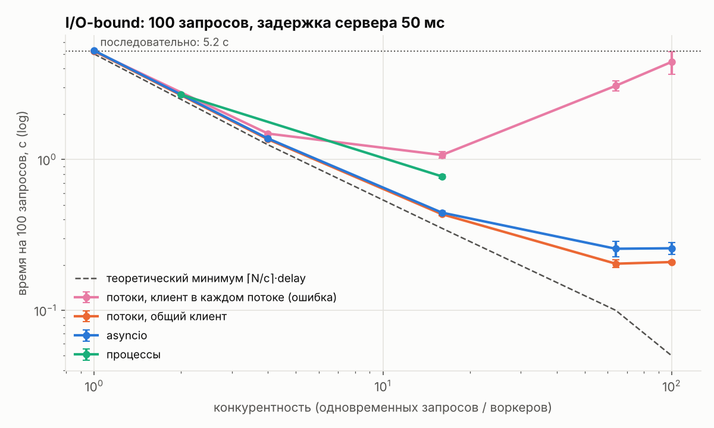
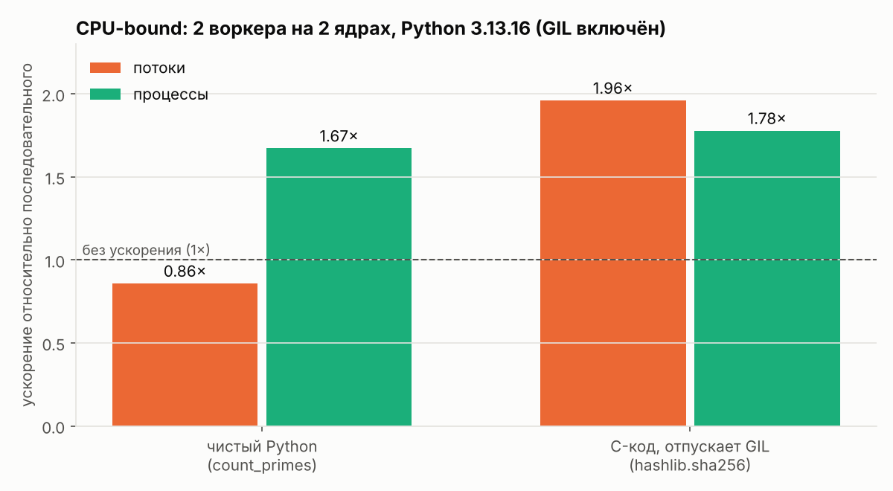
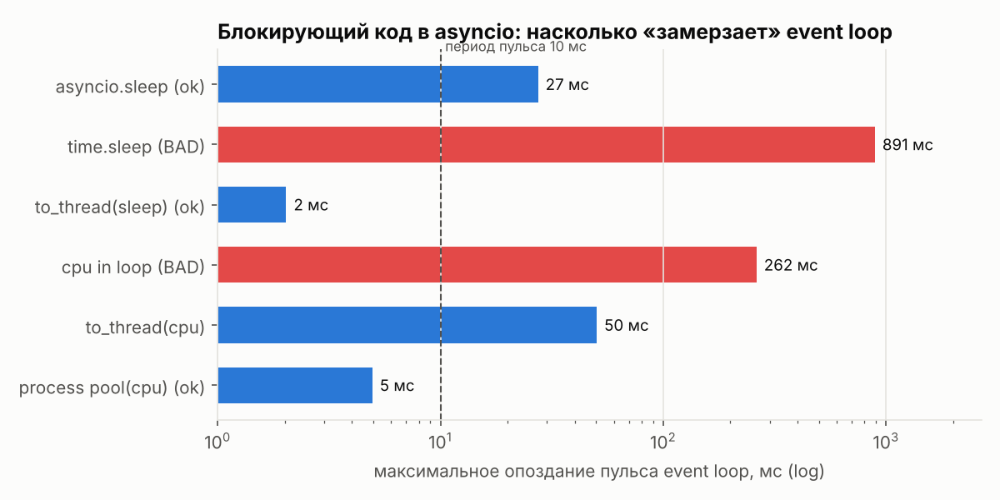
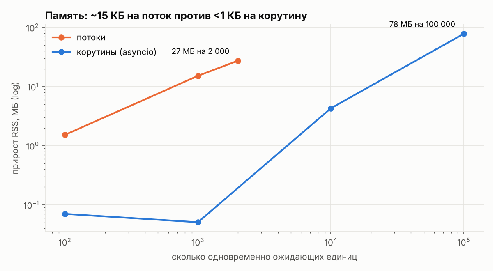

# concurrency-lab: threading vs multiprocessing vs asyncio в Python

Экспериментальное исследование: когда в Python использовать потоки, процессы
или asyncio. Пять воспроизводимых экспериментов, замеры с повторами
(mean ± std), разбор ошибок, найденных по ходу работы.

## TL;DR

- **I/O-bound (100 HTTP-запросов, задержка 50 мс):** потоки и asyncio одинаково
  ускоряют работу **в 20–25 раз** (5.2 с → 0.21–0.26 с). При такой нагрузке asyncio
  **не быстрее** потоков. Его преимущество — память и масштаб.
- **Ловушка:** свой HTTP-клиент в каждом потоке сделал 64 потока **в 15 раз медленнее**
  общего клиента. Создание `httpx.Client` стоит ~50 мс CPU, и под GIL эта работа
  идёт по очереди.
- **CPU-bound на чистом Python:** потоки дают **×0.86** (медленнее, GIL), процессы
  **×1.67** на 2 ядрах. Но если тяжёлую работу делает C-код, отпускающий GIL
  (`hashlib`), потоки дают **×1.96**. Миф «потоки бесполезны для CPU» верен
  только для чистого Python.
- **Один `time.sleep` в корутине** замораживает event loop на **891 мс**: все
  остальные клиенты ждут. `asyncio.to_thread` снижает это до 2 мс.
- **Память:** ~15 КБ RSS на поток против <1 КБ на корутину. 100 000 корутин
  занимают 78 МБ; 100 000 потоков ОС обычно просто не даст создать.
- **GIL не защищает от гонок:** check-then-act ломается и в потоках, и в asyncio
  (если между проверкой и действием есть `await`).



## Вопросы исследования

1. Какой подход быстрее для массовых сетевых запросов и как он масштабируется?
2. Действительно ли потоки бесполезны для вычислений? От чего это зависит?
3. Что происходит, если в asyncio-код попадает блокирующий вызов?
4. Защищает ли GIL от гонок данных? Бывают ли гонки в однопоточном asyncio?
5. Сколько ресурсов стоит один поток и одна корутина?

## Окружение

| | |
|---|---|
| Python | 3.13.16 (CPython, GIL включён) |
| CPU | 2 vCPU, Linux x86_64 (облачная VM) |
| Повторы | 3 на вариант, отчёт mean ± std |

> На другой машине абсолютные числа будут другими, а выводы должны сохраниться.
> Каждый JSON в `results/` содержит полное описание окружения.

## Методология

- **Локальный HTTP-сервер** с управляемой задержкой, запущенный в отдельном процессе.
  Это даёт воспроизводимость и известный теоретический минимум `⌈N/c⌉ · delay`.
- **Одна библиотека** (`httpx`) с одинаковым sync и async API: сравниваем модель
  исполнения, а не реализации разных библиотек.
- **Одинаковые уровни конкурентности** для потоков и asyncio.
- **Wall time + CPU time:** их соотношение показывает, ждёт процесс или считает.
- **Тесты корректности:** все варианты дают одинаковый результат.

Подробно о каждом решении и альтернативах: [docs/decisions.md](docs/decisions.md).

## Результаты

### 1. I/O-bound: 100 запросов к серверу с задержкой 50 мс

| Подход | c=1 | c=4 | c=16 | c=64 | c=100 | CPU при c=64 |
|---|---|---|---|---|---|---|
| Последовательно | 5.23 ± 0.06 | | | | | 0.15 с |
| Потоки, общий клиент | 5.22 | 1.36 | 0.43 | **0.20 ± 0.01** | 0.21 | 0.18 с |
| asyncio | 5.27 | 1.38 | 0.44 | 0.26 ± 0.03 | 0.26 | 0.17 с |
| Потоки, клиент на поток ⚠ | 5.22 | 1.48 | 1.07 | 3.08 ± 0.24 | 4.43 | **5.84 с** |

*Время в секундах. Теоретический минимум при c=64: 0.10 с.
Процессы: 2.69 ± 0.02 с при 2 воркерах, 0.77 ± 0.02 с при 16.*

**Выводы:**
- До c≈16 обе модели почти совпадают с теоретическим минимумом: накладные расходы ничтожны.
- При c≥64 упираемся в CPU-накладные расходы самого клиента (разбор HTTP на Python),
  а не в ожидание: реальное время в 2 раза выше теоретического.
- Потоки и asyncio на этом масштабе **статистически почти равны**. Гипотеза
  «asyncio быстрее» **не подтвердилась**. Его преимущество проявляется в памяти (эксп. 5)
  и при тысячах одновременных соединений.
- Процессы для I/O проигрывают: запуск интерпретаторов и pickle стоят дорого,
  а параллелизм на CPU здесь не нужен.

### 2. CPU-bound: где GIL мешает, а где нет



- **Чистый Python:** потоки **медленнее** последовательного кода (×0.86). Потоки
  борются за GIL, и это добавляет накладные расходы переключения. Процессы дают
  ×1.67 из теоретических ×2 (потери на запуск процессов и неравномерность кусков).
- **hashlib:** потоки дают ×1.96. Во время хеширования GIL отпущен, оба ядра
  работают. Процессы чуть хуже (×1.78) из-за накладных расходов.
- **Практический вывод для ML:** NumPy/PyTorch отпускают GIL, поэтому потоки в них
  работают. А предобработка на чистом Python (аугментации, парсинг) требует
  процессов. Поэтому `DataLoader(num_workers=N)` использует процессы.

### 3. Блокирующий вызов внутри asyncio



Фоновая корутина «пульсирует» каждые 10 мс и фиксирует опоздания.

| Сценарий (3 задачи) | Общее время | Макс. опоздание пульса |
|---|---|---|
| `await asyncio.sleep(0.3)` | 0.30 с | 27 мс* |
| `time.sleep(0.3)` ❌ | **0.90 с** | **891 мс** |
| `await asyncio.to_thread(time.sleep, 0.3)` | 0.30 с | 2 мс |
| Расчёт прямо в корутине ❌ | 0.27 с | 262 мс |
| `asyncio.to_thread(расчёт)` | 0.34 с | 50 мс (медиана 5.4 мс) |
| `run_in_executor(ProcessPool, расчёт)` | 0.16 с | 5 мс |

\* *Единичный выброс; медиана 0.2 мс.*

- `time.sleep` в корутине не только тормозит loop, но и **сериализует** задачи:
  3 × 0.3 = 0.9 с вместо 0.3 с.
- CPU-работа в `to_thread` лучше, чем в loop, но не идеальна. Поток держит GIL,
  и loop получает его примерно раз в `switchinterval` = 5 мс; отсюда медиана
  опоздания 5.4 мс. Для тяжёлых расчётов нужен пул **процессов**.

### 4. Гонки данных

Полный вывод: [results/exp04_race_conditions.txt](results/exp04_race_conditions.txt)

| Сценарий | Результат |
|---|---|
| `self.value += 1`, 8 потоков × 100 000 | 800 000. Обновления **не потерялись** (см. ниже почему) |
| чтение → вызов функции → запись, без lock | **447 646 (потеряно 44%)** |
| то же с `threading.Lock` | 800 000 ✔ |
| Списание 10 × 100 при балансе 100, потоки без lock | баланс **−900** |
| asyncio, без `await` между проверкой и списанием | 0 ✔ (атомарно без всяких локов) |
| asyncio, с `await` между проверкой и списанием | баланс **−900** |
| asyncio с `asyncio.Lock` | 0 ✔ |
| Два лока в разном порядке | **deadlock** (пойман по таймауту) |
| Единый порядок захвата | ok ✔ |

**Неожиданная находка:** простой `+=` на CPython 3.13 с GIL не терял обновления
даже при `switchinterval=1e-6`. В CPython 3.10+ поток отдаёт GIL только в
определённых точках (вызовы функций, переходы назад в циклах), а между чтением и
записью в `+=` таких точек нет. **Это деталь реализации, а не гарантия:** на
free-threaded сборке, в PyPy или в будущей версии код сломается. Один вызов
функции между чтением и записью, и теряется 44% обновлений.

### 5. Память: поток vs корутина



| | на единицу | 1 000 шт. | 100 000 шт. |
|---|---|---|---|
| Поток | ~15 КБ RSS, ~0.09 мс создание | 15 МБ | (ОС ограничит раньше) |
| Корутина (Task) | <1 КБ, ~6 мкс создание | ~0.1 МБ | 78 МБ |

*Для малых N замер корутин упирается в точность RSS: аллокатор Python
переиспользует уже выделенную память, поэтому значения при N ≤ 1000 шумные.*

## Итог: как выбирать

| Задача | Выбор | Почему |
|---|---|---|
| Много сетевых запросов, есть async-библиотеки | **asyncio** | Дёшево по памяти, масштабируется на тысячи соединений |
| Немного I/O, синхронные библиотеки, легаси-код | **ThreadPoolExecutor** | Проще, работает с любым кодом, по скорости не уступает |
| Тяжёлые вычисления на чистом Python | **ProcessPoolExecutor** | Единственный способ задействовать ядра при GIL |
| Вычисления в NumPy / PyTorch / C | **потоки** или векторизация | GIL отпущен, процессы не нужны |
| Блокирующий вызов в async-коде | **`asyncio.to_thread`** | Не замораживает event loop |
| CPU-работа в async-сервисе | **`run_in_executor` + ProcessPool** | Loop остаётся свободным |

## Что не сработало и чему научило

1. **«Клиент в каждом потоке ради изоляции»** оказался главным тормозом.
   Урок: дорогие объекты (HTTP-клиенты, подключения к БД, модели) создавай
   **один раз** и переиспользуй. Аномалию нашёл по росту CPU-времени: время
   ожидания не может стоить CPU.
2. **Процессы с `httpx.get()` на каждый запрос** были в 2 раза медленнее
   исправленной версии по той же причине.
3. **Гонка с `+=` не воспроизвелась** «в лоб». Пришлось разобраться, где CPython
   переключает потоки. Урок: «тест прошёл» не значит «гонки нет».

## Ограничения

- 2 vCPU. Масштабирование процессов на 8+ ядрах не проверено.
- Сервер локальный: нет реальной сетевой задержки, потерь пакетов и TLS.
- 3 повтора: для тонких различий (потоки vs asyncio при c≥64) нужно больше.
- Не проверен free-threaded Python (3.13t/3.14t). Это следующий шаг.

## Следующие шаги

- [ ] Прогнать exp02 на free-threaded Python 3.14t
- [ ] Масштаб 10 000+ одновременных соединений: где ломаются потоки
- [ ] Producer–consumer на `asyncio.Queue` с backpressure
- [ ] `uvloop` вместо стандартного event loop

## Воспроизведение

```bash
git clone https://github.com/<you>/concurrency-lab && cd concurrency-lab
python -m venv .venv && source .venv/bin/activate     # Windows: .venv\Scripts\activate
pip install -e ".[dev]"

pytest                                    # тесты корректности
python experiments/exp01_io_bound.py      # ~2 мин
python experiments/exp02_cpu_bound.py     # ~1 мин
python experiments/exp03_blocking_in_async.py
python experiments/exp04_race_conditions.py
python experiments/exp05_memory_footprint.py
python scripts/plot_results.py            # графики в results/
```

## Структура

```
concurrency-lab/
├── src/concurrency_lab/
│   ├── bench.py        # замеры: повторы, mean ± std, окружение, сохранение в JSON
│   ├── server.py       # локальный async HTTP-сервер с ?delay=
│   └── workloads.py    # CPU-нагрузки (чистый Python и hashlib)
├── experiments/        # 5 экспериментов, каждый — отдельный скрипт с гипотезой в docstring
├── scripts/plot_results.py
├── tests/              # тесты корректности
├── results/            # сырые данные (JSON) и графики (PNG)
└── docs/
    ├── decisions.md    # почему сделано так, а не иначе
    └── notes/theory.md # конспект теории: GIL, event loop, гонки, шпаргалка выбора
```
# concurrency-lab

